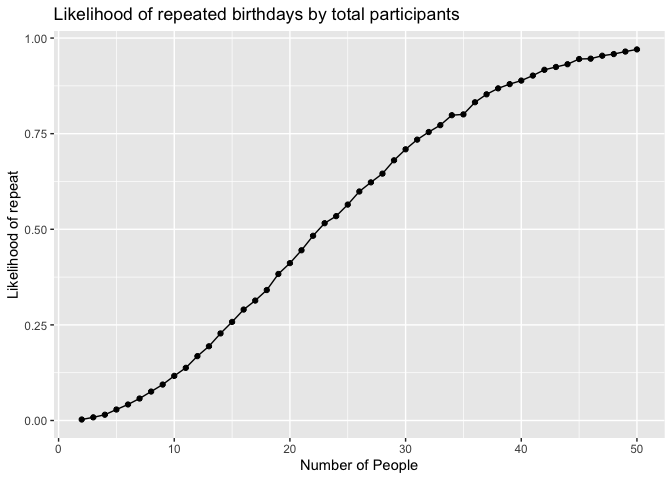
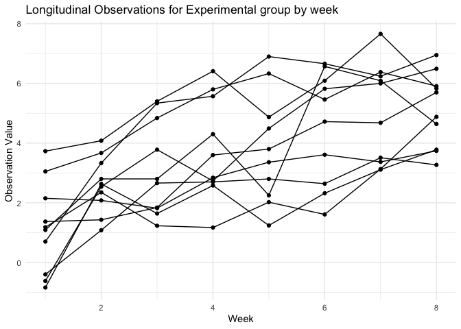
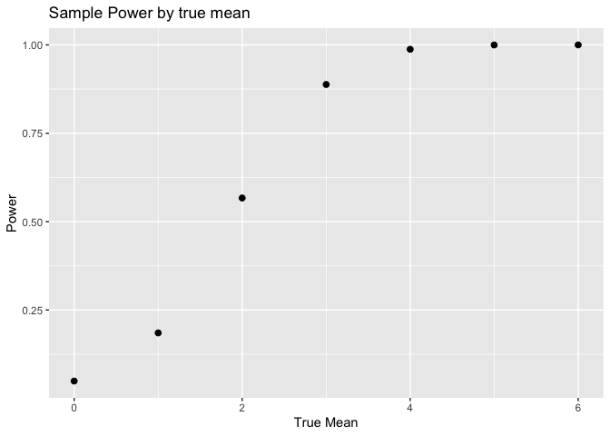
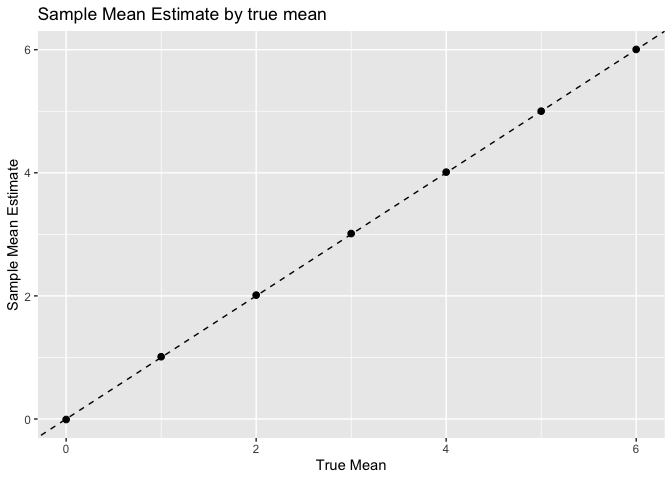
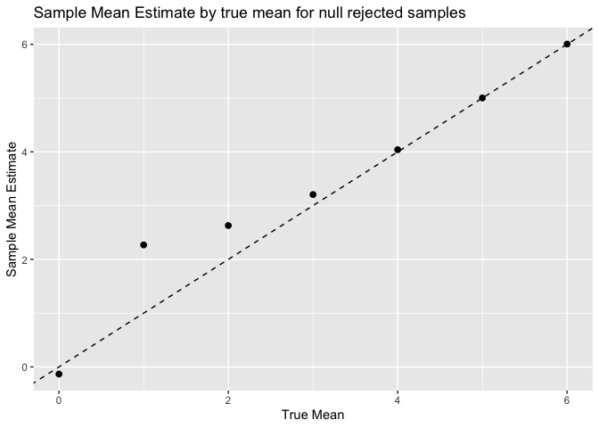

p8105_hw5_fs2968
================
2026-11-15

Import necessary libraries

``` r
library(tidyverse)
```

    ## ── Attaching core tidyverse packages ──────────────────────── tidyverse 2.0.0 ──
    ## ✔ dplyr     1.2.1     ✔ readr     2.2.0
    ## ✔ forcats   1.0.1     ✔ stringr   1.6.0
    ## ✔ ggplot2   4.0.3     ✔ tibble    3.3.1
    ## ✔ lubridate 1.9.5     ✔ tidyr     1.3.2
    ## ✔ purrr     1.2.2     
    ## ── Conflicts ────────────────────────────────────────── tidyverse_conflicts() ──
    ## ✖ dplyr::filter() masks stats::filter()
    ## ✖ dplyr::lag()    masks stats::lag()
    ## ℹ Use the conflicted package (<http://conflicted.r-lib.org/>) to force all conflicts to become errors

``` r
set.seed(1)
```

# Problem 1

First, we need to create our function that takes n people in a room,
randomly draws “birthdays” for each person, checks whether there are
duplicate birthdays in the group, and returns TRUE or FALSE based on the
result.

``` r
#Create our function that takes n
birthday_func = function(n) {
  #Create our random sample of birthdays, options from 1 to 365 with replacement set to True 
  birthdays = sample(1:365, size=n, replace=TRUE)
  #check if there are any duplicates
  result = length(unique(birthdays)) < n
  return(result)
}
```

Now that we have created this function, we can run this function 10,000
times for each group size from 2 to 50, and calculate the average number
of instances where there are repeated birthdays found.

``` r
birthday_result = 
  expand.grid(
    num = 2:50,
    iter = 1:10000
  ) |> 
  mutate(
    repeated = map_lgl(num, birthday_func)
  )


birthday_result |> 
  group_by(num) |> 
  summarize(prob_of_repeat = mean(repeated)) |> 
  ggplot(aes(x = num, y =prob_of_repeat)) + 
  geom_point()+
  geom_line() + 
  labs(
    title = "Likelihood of repeated birthdays by total participants",
    x = "Number of People",
    y = "Likelihood of repeat"
  ) 
```

<!-- -->

As we can see in the plot above, the number of people needed to have at
least a 50 percent chance of having at least one repeated birthday is 23
individuals. We can also see that at 50 participants, the likelihood of
at least one repeated birthday is nearly 100 percent.

# Problem 2

We first import the data from all participants and tidy them.

``` r
#Creating our df
df = 
  #Create dataframe with all filepaths included
  tibble(
    filepath = list.files("data", full.names = TRUE, pattern = "^.*\\.csv$"),
  ) |> 
  #Mutate so that we add a row with the data from each file
  mutate( 
    data = map(
      filepath, 
      \(path) read_csv(path, na = c("NA", ".", ""), show_col_types = FALSE)
    ), 
    #remove the .csv the filename and the folder name
    filepath = str_remove(basename(filepath), "\\.csv$")
  ) |>
  #Separate the file name into arm and subject id
  separate(
    filepath,
    into = c("arm", "subject_id"),
    sep = "_"
  ) |> 
  #unnest the data since its in a tibble
  unnest(data) |> 
  #Pivot longer so that the weeks are in their own column/tidy the data
  pivot_longer(
    cols = starts_with("week_"),
    names_to = "week",
    names_prefix = "week_",
    values_to = "observation"
  ) |> 
   #change subject id and week to numeric
  mutate(
    subject_id = as.numeric(subject_id),
    week = as.numeric(week)
  )
```

Now that we have created our dataframe with the subject ID, arm, week
and observation, we can make a spaghetti plot showing observations on
each subject over time.

``` r
df |> 
  filter(arm == "con") |> 
  ggplot(aes(x = week, y = observation, group = subject_id)) +
  geom_point() +
  geom_line() + 
  labs(
    title = "Longitudinal Observations for Control group by week",
    x = "Week",
    y = "Observation Value"
  ) +
  theme_minimal() +
  theme(legend.position = "right")
```

<!-- -->

``` r
df |> 
  filter(arm == "exp") |> 
  ggplot(aes(x = week, y = observation, group = subject_id)) +
  geom_point() +
  geom_line() + 
  labs(
    title = "Longitudinal Observations for Experimental group by week",
    x = "Week",
    y = "Observation Value"
  ) +
  theme_minimal() +
  theme(legend.position = "right")
```

<!-- -->

In the plots above comparing the observations over weeks between the
control arm and the experimental arm, we can see that the control arm
observations have no significant increase or decrease over the 8 weeks,
with the final week of observation having a similar distribution/spread
to the initial observations with the difference between week 1 and week
8 at -0.175 on average. However, in the experimental arm, we see a
gradual increase in observation over time, with the difference between
week 1 and week 8 observations at 3.978 on average.

# Problem 3

Since we are looking to repeat our normal sampling several times, we
define a function that will do the 5,000 repeated samples for us.

``` r
#Set Parameters
n = 30
sigma = 5

#Create our function
norm_samp = function(n, sigma, mu) {
  #Create a list for our results
  output = vector("list", 5000)
  #Iterate through 5,000 samples 
  for (i in 1:5000) {
    x = rnorm(n, mu, sigma)
    output[[i]] = broom::tidy(t.test(x, conf.level = 0.95))
  }
  output = bind_rows(output)
  return(output)
}

#Simulate when mean is 0
zero_mean_samp = norm_samp(n, sigma, 0)
```

Now we can repeat this sampling for mean set to 1,2,3,4,5,6, seeing how
the p.value changes as we change the mean.

``` r
# repeat for mean 1,2,3,4,5,6

sample_df = tibble(
  true_mean = c(0,1,2,3,4,5,6),
  statistics = map(true_mean, \(mu) norm_samp(n, sigma, mu))
  ) 
```

Now that we’ve generated our data for each true mean, we can make a plot
showing the proportion of times the null was rejected compared to the
true mean that was set.

``` r
sim_summary = 
  sample_df |> 
  unnest(statistics) |> 
  group_by(true_mean) |> 
  summarize(
    avg_estimate_all = mean(estimate),
    avg_estimate_rejected = mean(estimate[p.value < 0.05]),
    power = mean(p.value < 0.05)
  )

sim_summary |> 
  ggplot(aes(x = true_mean, y = power)) + 
  geom_point(size = 2) + 
  labs(
    title = "Sample Power by true mean ",
    x = "True Mean",
    y = "Power"
  ) 
```

<!-- -->

As we can see in the plot, there is a positive association between the
true mean and power. This means that as the true mean increases, the
likelihood of a correctly rejecting the null hypothesis increases. This
makes sense as the true mean moves further away from our null hypothesis
of mean is zero, the more likely we are to find statistically
significant samples where the sample mean differs from the null
hypothesis and thus decreasing the type 2 error (false rejections).

Now we can make a plot showing the average estimate of mu between true
means. Then the following plot will be the average estimates only when
the null hypothesis is rejected.

``` r
sim_summary |> 
  ggplot(aes(x = true_mean, y = avg_estimate_all)) + 
  geom_point(size = 2) + 
  geom_abline(slope = 1, intercept = 0, linetype = "dashed") +
  labs(
    title = "Sample Mean Estimate by true mean ",
    x = "True Mean",
    y = "Sample Mean Estimate"
  ) 
```

<!-- -->

``` r
sim_summary |> 
  ggplot(aes(x = true_mean, y = avg_estimate_rejected)) + 
  geom_point(size = 2) + 
  geom_abline(slope = 1, intercept = 0, linetype = "dashed") +
  labs(
    title = "Sample Mean Estimate by true mean for null rejected samples",
    x = "True Mean",
    y = "Sample Mean Estimate"
  ) 
```

<!-- -->

As we can see in the plots, the graph for the sample mean estimate in
all samples is nearly identical to the true mean, while in the plot for
only the null rejected samples, we can see that the estimated
mean/sample mean is slightly higher than the true mean for true mean
1,2,3, and then is equal to the true mean at 4,5, and 6. This is because
for the lower true means, our samples are more likely to have sample
means that are further away from the null hypothesis since these are the
statistically significant samples where we reject the null, which is set
at 0. Samples that have a mean closer to 0 may not be rejected, and thus
not included in this filtered dataset. That is until we reach a true
mean value where the sample mean is on average already far enough away
from the null so that most sampels will reject the null hypothesis and
therefore average the sample mean.
