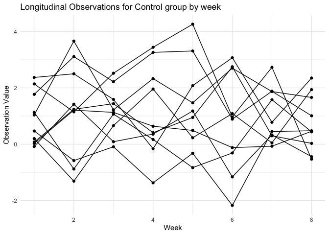

p8105_hw5_fs2968
================
2026-11-15

Import necessary libraries

``` r
library(tidyverse)
```

    ## ── Attaching core tidyverse packages ──────────────────────── tidyverse 2.0.0 ──
    ## ✔ dplyr     1.2.1     ✔ readr     2.2.0
    ## ✔ forcats   1.0.1     ✔ stringr   1.6.0
    ## ✔ ggplot2   4.0.3     ✔ tibble    3.3.1
    ## ✔ lubridate 1.9.5     ✔ tidyr     1.3.2
    ## ✔ purrr     1.2.2     
    ## ── Conflicts ────────────────────────────────────────── tidyverse_conflicts() ──
    ## ✖ dplyr::filter() masks stats::filter()
    ## ✖ dplyr::lag()    masks stats::lag()
    ## ℹ Use the conflicted package (<http://conflicted.r-lib.org/>) to force all conflicts to become errors

# Problem 1

First, we need to create our function that takes n people in a room,
randomly randomly draws “birthdays” for each person, checks whether
there are duplicate birthdays in the group, and returns TRUE or FALSE
based on the result.

``` r
#Create our function that takes n
birthday_func = function(n) {
  #Create our random sample of birthdays, options from 1 to 365 with replacement set to True 
  birthdays = sample(1:365, size=n, replace=TRUE)
  #check if there are any duplicates
  result = length(unique(birthdays)) < n
  return(result)
}
```

Now that we have created this function, we can run this function 10,000
times for each group size from 2 to 50, and calculate the average number
of instances where there are repeated birthdays found.

``` r
birthday_result = 
  expand.grid(
    num = 2:50,
    iter = 1:10000
  ) |> 
  mutate(
    repeated = map_lgl(num, birthday_func)
  )


birthday_result |> 
  group_by(num) |> 
  summarize(prob_of_repeat = mean(repeated)) |> 
  ggplot(aes(x = num, y =prob_of_repeat)) + 
  geom_point()+
  geom_line()
```

<!-- -->

As we can see in the plot above, the number of people needed to have at
least a 50 percent chance of having at least one repeated birthday is 23
individuals. We can also see that at 50 participants, the likelihood of
at least one repeated birthday is nearly 100 percent.

# Problem 2

We first import the data from all participants and tidy them.

``` r
#Creating our df
df = 
  #Create dataframe with all filepaths included
  tibble(
    filepath = list.files("data", full.names = TRUE, pattern = "^.*\\.csv$"),
  ) |> 
  #Mutate so that we add a row with the data from each file
  mutate( 
    data = map(
      filepath, 
      \(path) read_csv(path, na = c("NA", ".", ""), show_col_types = FALSE)
    ), 
    #remove the .csv the filename and the folder name
    filepath = str_remove(basename(filepath), "\\.csv$")
  ) |>
  #Separate the file name into arm and subject id
  separate(
    filepath,
    into = c("arm", "subject_id"),
    sep = "_"
  ) |> 
  #unnest the data since its in a tibble
  unnest(data) |> 
  #Pivot longer so that the weeks are in their own column/tidy the data
  pivot_longer(
    cols = starts_with("week_"),
    names_to = "week",
    names_prefix = "week_",
    values_to = "observation"
  ) |> 
   #change subject id and week to numeric
  mutate(
    subject_id = as.numeric(subject_id),
    week = as.numeric(week)
  )
```

Now that we have created our dataframe with the subject ID, arm, week
and observation, we can make a spaghetti plot showing observations on
each subject over time.

``` r
df |> 
  filter(arm == "con") |> 
  ggplot(aes(x = week, y = observation, group = subject_id)) +
  geom_point() +
  geom_line() + 
  labs(
    title = "Longitudinal Observations for Control group by week",
    x = "Week",
    y = "Observation Value",
    color = "Study Arm"
  ) +
  theme_minimal() +
  theme(legend.position = "right")
```

    ## Ignoring unknown labels:
    ## • colour : "Study Arm"

<!-- -->

``` r
df |> 
  filter(arm == "exp") |> 
  ggplot(aes(x = week, y = observation, group = subject_id)) +
  geom_point() +
  geom_line() + 
  labs(
    title = "Longitudinal Observations for Experimental group by week",
    x = "Week",
    y = "Observation Value",
    color = "Study Arm"
  ) +
  theme_minimal() +
  theme(legend.position = "right")
```

    ## Ignoring unknown labels:
    ## • colour : "Study Arm"

<!-- -->

In the plots above comparing the observations over weeks between the
control arm and the experimental arm, we can see that the control arm
observations have no significant increase or decrease over the 8 weeks,
with the final week of observation having a similar distribution/spread
to the intial observations with the difference between week 1 and week 8
at -0.175 on average. However, in the experimental arm, we see a gradual
increase in observation over time, with the difference between week 1
and week 8 observations at 3.978 on average.
